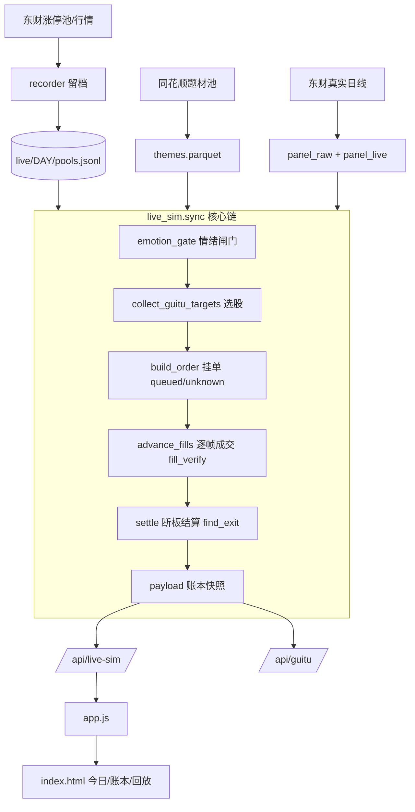
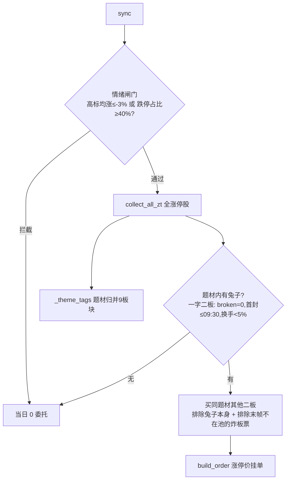
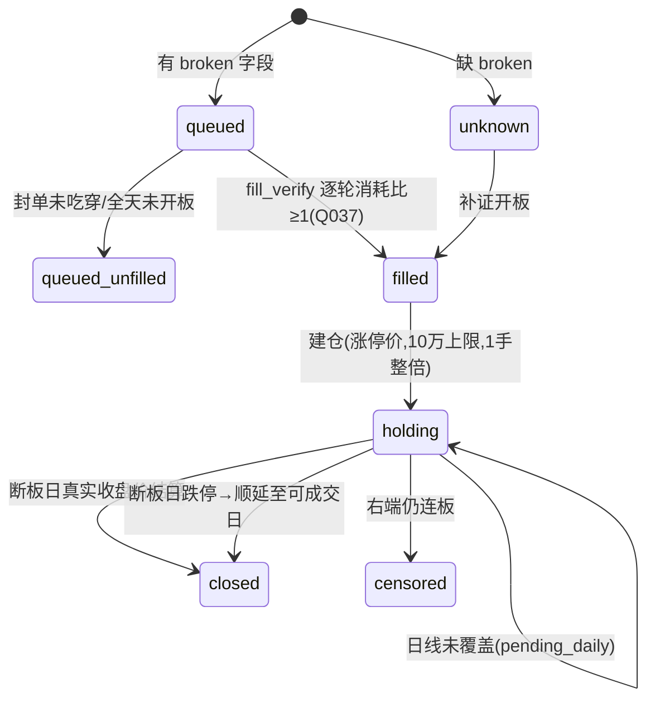

# 悟空真经 · 全流程图 / 算法逻辑 / 核对文档

> 生成：2026-11-23 ｜ 项目：`E:\workspace\量化` ｜ 策略：**E5:B1 悟空真经·二板排板**
> 成本口径（用户 2026-11-23 裁定）：**万 0.84 免五** 单一口径
> 选股口径（用户 2026-11-23 确认，唯一权威）：**题材内有一字兔 → 买同题材其他二板；无组合则不开仓**

---

## 0. 一句话定位

在涨停池中找「同题材出现一字二板（兔子）」的题材，买入该题材内其他二板（乌龟）；
买点是二板封板瞬间以涨停价挂单排队（Q037：不开板不成交、开板且卖一有单才成交、成交价=涨停价）；
卖点是首个未涨停日（断板）当日收盘；断板日跌停封死则顺延到下一个可成交交易日；
只写本地 JSON 账本，永不向券商/账户发送指令。

---

## 1. 板块清单（精简后）

### 1.1 后端（`live_terminal/backend/`，21 个模块全部服务悟空）

| 模块 | 角色 |
|---|---|
| `live_sim.py` | **B1 策略本体**：情绪闸门→选股→挂单→逐帧成交→断板结算→账本 |
| `queue_match.py` | Q037 排板规则 + 今日队列观察表（展示用，**非实际选股**） |
| `fill_verify.py` / `minute_flow.py` | 逐轮封单消耗成交模拟 / 腾讯分钟成交额 |
| `intraday_signal.py` | 分时还原首封/开板次数（交叉核对） |
| `guitu_roles.py` | 兔子/乌龟/盘子偏大标注（**只标注，不过滤**） |
| `guitu_cases.py` | 龟兔案例/命题检验（后端只读，前端已隐藏） |
| `guitu_backtest.py` | 二板排板历史回放（乐观上界，非真实成交） |
| `leader_ladder.py` / `leader_casebook.py` | 案例证据链支撑 |
| `theme_pool.py` + `configs/theme_axis.yaml` | 题材池读取（9 板块归并）——**选股分组关键** |
| `feeds.py` / `recorder.py` | 真实日线合并视图 / 涨停池留档线程 |
| `market_clock.py` / `dates.py` / `paths.py` / `json_safe.py` | 交易时钟 / 日期归一化 / 路径 / NaN 净化 |
| `feature_engine.py` / `costs.py` / `trading_rules.py` / `limit_counts.py` | 涨停判据 / **万0.84免五成本** / 涨跌停价 / 涨跌停家数 |

### 1.2 前端（`web/`，4 文件，3 区块：今日/账本/回放）

- `index.html`：龟兔案例库板块**已全部隐藏**（含导航）；成本表改为单一口径。
- `app.js`：3 个 GET（health/live-sim/guitu）+ POST refresh；**不拼策略结论**；不再请求 `/api/guitu-cases`。
- `style.css` / `favicon.svg`：样式与图标。

### 1.3 数据（真实落盘）

`panel_raw.parquet`（只读日线）、`panel_live.parquet`（当日 bar）、
`live/<day>/pools/pools.jsonl`（涨停池留档，选股/成交核心）、
`themes/themes.parquet`（题材分组）、`paper/sim_state.json`（账本）、
`guitu_sim.json`（历史回放）、`weekly_review.json`（命题检验静态证据）。

---

## 2. 全流程图（Mermaid）

### 2.1 选股子流程

### 2.2 成交与结算状态机

---

## 3. 算法逻辑核对

### 3.1 选股（唯一权威口径）
- 兔子 = 二板(streak==2) + 一字形态（broken_max=0、首封≤09:30、换手<5%）。
- 同题材（theme_axis 归并 9 板块）内：有兔子 且 有其他二板 → 买其他二板。
- 其他二板须在末帧仍在涨停池（排除早盘封一下就炸的）；无组合则不开仓，不硬凑。

### 3.2 成交（Q037）
- `build_order` 只挂单，不用全天 broken_max 预判（消除未来函数）。
- `advance_fills` 逐帧推进：`fill_verify.simulate_fill` 逐轮比较开板前封单额与开板期成交额，消耗比≥1 判排到；无队列数据退回二元判定并标 unverified。成交价=涨停价。

### 3.3 结算
- 首个未涨停日（断板）按真实日线收盘价卖；断板日跌停封死→顺延到首个收盘不跌停日；日线未覆盖→holding/pending_daily 不猜价；右端仍连板→censored。日期比较统一 `dates.norm_day()`。

### 3.4 成本（用户裁定：万0.84免五，单一口径）
- `costs.DEFAULT = CostModel(commission_rate=0.000084, min_commission=0.0)`
- 往返成本率 = 0.000084×2 + 0.0005（印花卖）+ 0.00001×2（过户）+ 0.0015×2（滑点） = **0.003688**（0.3688%），与成交额无关（免五）。
- `LEGACY_DEFAULT`（万2.5+最低5元）仅供历史报告复现；历史已结算记录保留原值不重算。
- 历史回放置换为单一成本 + 毛收益对照。

### 3.5 数据真实性
- 只读真实落盘；无委托显示"今日不开仓"不回退历史单；停牌静默跨日；零券商接口。

---

## 4. 核对结论

| 项目 | 状态 |
|---|---|
| 选股口径（题材内一字兔→买其他二板） | ✅ 唯一权威，全文档统一 |
| 龟兔案例库前端板块 | ✅ 已隐藏（后端只读保留） |
| 成本万0.84免五单一口径 | ✅ `costs.DEFAULT`，`cost_rate=0.003688`，三口径已删 |
| 测试 | ✅ 300 passed |
| API 冒烟 | ✅ 6 接口 200 |

**深度复盘见** [`亏损复盘与未买入二板因子研究.md`](亏损复盘与未买入二板因子研究.md)：
8 笔已结算（1胜7负）主要是旧「全部二板」口径产物；亏损放大器是断板跌停顺延；
11-18 选股方向对但卡在成交（4只选中0建仓）；alpha 可能在选股、瓶颈在执行。

---

## 5. 已知边界 / 风险控制（未接线上）

- 奖惩/蚁群/自我进化机制（旧 `path_learning.py`/`feedback.py`/`strategy_freeze.py`）**已删除且当时处于 OBSERVATION_ONLY 冻结态**，未真正启用——当前是静态规则系统。
- 因子研究（封单消耗比预警、乌龟 broken/换手过滤等）样本仅 4 日 8 笔，属假设非证据，禁止直接调参上线（详见复盘报告）。
- 题材池覆盖不全时 tags 为空→不开仓（不是策略失效）。
